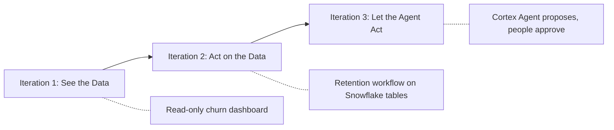
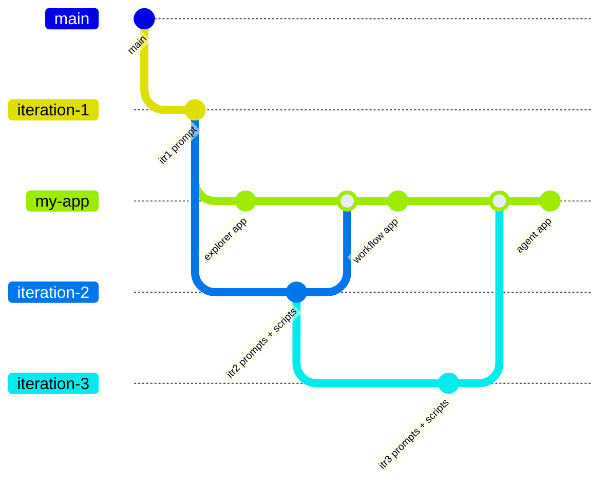
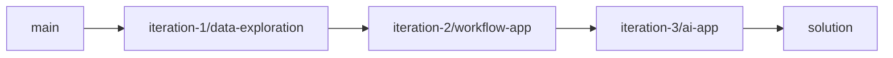

<!--
  Copyright 2026 Snowflake Inc.
  SPDX-License-Identifier: Apache-2.0
  
  Licensed under the Apache License, Version 2.0 (the "License");
  you may not use this file except in compliance with the License.
  You may obtain a copy of the License at
  
      http://www.apache.org/licenses/LICENSE-2.0
  
  Unless required by applicable law or agreed to in writing, software
  distributed under the License is distributed on an "AS IS" BASIS,
  WITHOUT WARRANTIES OR CONDITIONS OF ANY KIND, either express or implied.
  See the License for the specific language governing permissions and
  limitations under the License.
-->
# Build Full-Stack Apps with Snowflake App Runtime

[](LICENSE)

> **Follow the step-by-step guide:** [Build Full-Stack Apps with Snowflake App Runtime](https://www.snowflake.com/en/developers/guides/build-full-stack-apps-with-snowflake-app-runtime/?utm_source=github&utm_medium=repo&utm_campaign=sar-churnguard&utm_content=sfguide-sar-fullstack). This repo is its companion: setup scripts, prompts, and a reference solution.

Build and deploy **ChurnGuard**, a full-stack web app on Snowflake, in three progressive iterations: an interactive dashboard, then a workflow app, then an AI-powered agentic experience. Each iteration is driven by a prompt you paste into [Cortex Code Desktop](https://docs.snowflake.com/en/user-guide/cortex-code/cortex-code).

## Narrative Arc



| Iteration | App Type | What You Build |
|-----------|----------|----------------|
| 1 - Explorer | Advanced data exploration | Churn risk dashboard with KPIs, segment charts, trend charts |
| 2 - Workflow | Workflow app | Action Board, retention action forms, write-back to a Snowflake table, dynamic tables, alert-driven notifications |
| 3 - Agent | AI app with Cortex Agent | Chat panel, playbook-grounded proposals, Agent Suggested tab, daily staging task, MCP server |

Each iteration builds on the previous one, and each one produces a deployable app, so you can stop after any of them.

## Prerequisites

- A [Snowflake account](https://signup.snowflake.com/) with Snowflake App Runtime enabled and **ACCOUNTADMIN** privileges. In a hands-on lab, use the account your lab provides. Iteration 3 uses Cortex AI, which is off by default on self-service [trial accounts](https://docs.snowflake.com/en/user-guide/admin-trial-account) until you add a credit card.
- [Cortex Code Desktop](https://docs.snowflake.com/en/user-guide/cortex-code/cortex-code) installed and connected to your Snowflake account
- [Snowflake CLI](https://docs.snowflake.com/developer-guide/snowflake-cli/installation/installation) v3.26.0 or later, with a connection named `quickstart` (or change the name in `.env` and `AGENTS.md`). After `grants.sql`, set the connection's default `role` to `SFQUICKSTART_CHURNGUARD_ROLE` and `warehouse` to `SFQUICKSTART_CHURNGUARD_WH`: `snow app deploy` uses the connection's default role, not `--role`.
- [Node.js](https://nodejs.org/) 20+ and npm

## Quick Start

1. **Clone the repo:**

   ```bash
   git clone https://github.com/Snowflake-Labs/sfguide-build-full-stack-apps-with-snowflake-app-runtime.git
   cd sfguide-build-full-stack-apps-with-snowflake-app-runtime
   ```

2. **Run the setup scripts** (as ACCOUNTADMIN). `grants.sql` grants the new role to the user running it via `CURRENT_USER()`, so there is nothing to edit:

   ```bash
   snow sql -f scripts/setup.sql --connection quickstart
   snow sql -f scripts/grants.sql --connection quickstart
   snow sql -f scripts/setup-data.sql --connection quickstart
   ```

3. **Create your working branch** from iteration 1:

   ```bash
   git fetch origin
   git checkout -b my-app origin/iteration-1/data-exploration
   ```

4. **Set the default connection and role** from `.env.example`:

   ```bash
   cp .env.example .env
   echo dotenv > .envrc && direnv allow   # or: set -a; source .env; set +a
   ```

5. **Open the repo root in Cortex Code Desktop** and paste the iteration prompt (see below). `AGENTS.md` tells Cortex Code your connection, role, database, and conventions.

## Iterations

| Iteration | Merge into `my-app` | Setup | Prompts (in order) |
|-----------|---------------------|-------|--------------------|
| 1 | (start here) | `setup.sql`, `grants.sql`, `setup-data.sql` | [`01-build-explorer.md`](prompts/01-build-explorer.md) |
| 2 | `origin/iteration-2/workflow-app` | Rerun `grants.sql`, then `iteration-2-setup.sql` | [`02-add-workflow.md`](prompts/02-add-workflow.md) |
| 3 | `origin/iteration-3/ai-app` | Rerun `grants.sql`, then `iteration-3-setup.sql` | [`03-agent-setup.md`](prompts/03-agent-setup.md), [`03-add-agent.md`](prompts/03-add-agent.md) |

Prompt links resolve on the branch that adds them. Run every script with `snow sql -f scripts/<file> --connection quickstart`. The files in `scripts/reference/` record what the setup prompts create; you don't need to run them.

### Learner Git Flow

You only ever edit `churnguard/` on your own `my-app` branch. Commit your app after each iteration, then merge in the next iteration branch to pick up its prompts and scripts:



```bash
git add churnguard && git commit -m "Iteration 1: ChurnGuard explorer"
git fetch origin && git merge --no-edit origin/iteration-2/workflow-app
```

## Branch Guide



Each iteration branch builds on the one before it, so merging the next one into `my-app` adds only what's new.

| Branch | Adds |
|--------|------|
| `main` | `scripts/setup.sql`, `grants.sql`, `setup-data.sql`, `cleanup.sql`, `.env.example`, README, LICENSE |
| `iteration-1/data-exploration` | `AGENTS.md`, `prompts/01-build-explorer.md` |
| `iteration-2/workflow-app` | `prompts/02-add-workflow.md`, `scripts/iteration-2-setup.sql`, iteration 2 grants |
| `iteration-3/ai-app` | `prompts/03-agent-setup.md`, `prompts/03-add-agent.md`, `scripts/iteration-3-setup.sql`, `scripts/reference/agent-setup.sql`, iteration 3 grants and cleanup |
| `solution` | The complete `churnguard/` app through iteration 3 |

`churnguard/` exists only on `solution`. `main` and the iteration branches never contain it, so merging them into `my-app` never touches your app code.

**Using the solution.** It's a reference, so don't merge it into `my-app`. Compare against it, or browse it on [GitHub](https://github.com/Snowflake-Labs/sfguide-build-full-stack-apps-with-snowflake-app-runtime/tree/solution):

```bash
git fetch origin
git diff my-app origin/solution -- churnguard/
```

## Repository Layout

```
.
├── AGENTS.md          # Cortex Code environment and conventions (iteration branches)
├── prompts/           # IDD prompts, one or two per iteration
├── scripts/           # setup, grants, data, cleanup, plus per-iteration setup
│   └── reference/     # SQL the setup prompts run (reference only)
└── churnguard/        # the app (solution branch, or your my-app branch)
```

## Prompts

All prompts follow the [Intent-Driven Development (IDD)](https://dev.to/kameshsampath/series/41588) template:

```
[Goal]          -- desired outcome
[Requirements]  -- intent statements
[UI]            -- look, feel, interaction patterns
[Constraints]   -- scope and safety rules
[Output]        -- what success looks like
```

## Full Walkthrough

The full walkthrough, with screenshots, troubleshooting, and next steps, is at **[Build Full-Stack Apps with Snowflake App Runtime](https://www.snowflake.com/en/developers/guides/build-full-stack-apps-with-snowflake-app-runtime/?utm_source=github&utm_medium=repo&utm_campaign=sar-churnguard&utm_content=sfguide-sar-fullstack)**.

## Usage Markers

The ChurnGuard app you build carries one anonymous label: an `APP_ORIGIN` environment variable in `app.yml`. It tells Snowflake DevRel that an app started from this quickstart, so we can see which guides lead to apps people keep using. It holds no customer data, and the app works the same without it. To opt out, delete it (see [`AGENTS.md`](AGENTS.md) on an iteration branch).

## Cleanup

```bash
snow sql -f scripts/cleanup.sql --connection quickstart
```

## Maintainers

End-to-end tests that run this quickstart with Cortex Code live in [`tests/e2e/`](tests/e2e/README.md). Learners don't need them.

## License

Copyright (c) Snowflake Inc. All rights reserved.

Licensed under the [Apache 2.0](https://www.apache.org/licenses/LICENSE-2.0) license.
