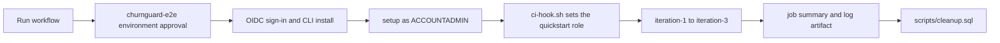

<!--
  Copyright 2026 Snowflake Inc.
  SPDX-License-Identifier: Apache-2.0
  
  Licensed under the Apache License, Version 2.0 (the "License");
  you may not use this file except in compliance with the License.
  You may obtain a copy of the License at
  
      http://www.apache.org/licenses/LICENSE-2.0
  
  Unless required by applicable law or agreed to in writing, software
  distributed under the License is distributed on an "AS IS" BASIS,
  WITHOUT WARRANTIES OR CONDITIONS OF ANY KIND, either express or implied.
  See the License for the specific language governing permissions and
  limitations under the License.
-->
# E2E tests (maintainers only)

These tests run the whole quickstart the way a learner would: [Cortex Code](https://docs.snowflake.com/en/user-guide/cortex-code/cortex-code) follows the guide and the `prompts/` from `setup` through `iteration-3`, and records E2E checks and friction as it goes. Learners don't need anything in this folder, and none of it is part of the quickstart.

| File | Purpose |
|------|---------|
| `prompt-core.md` | Generic harness prompt: goal, guardrails, ambiguity, flow and consistency reviews, log format |
| `stages.md` | This guide's part of the prompt: object prefixes, roles, script order, extra guardrails, and the E2E checks for each `## STAGE:` |
| `harness.env` | About the guide, for the scripts (committed): stage list, guide title, required tools, companion repo, and the role and warehouse the connection must default to after the first stage |
| `run-stage.sh` | Runs one stage with `cortex exec` (retries model-stream drops, streams the log, prints the stage's elapsed time) |
| `env.sh`, `.env.test.example` | About your run: copy to `.env.test` (git-ignored) for the guide URL, `GUIDE_MD` and connection. Precedence: shell, `.env.test`, `harness.env` |
| `run-all.sh` | Runs every stage in order, stops on a failure or a `Blocked` section, resumes from a stage, prints per-stage and total time |
| `summarize.sh` | Prints checks, friction, the consistency review and a guide-fix list; fails on any `FAIL` check or `BLOCKER` friction |
| `test-summarize.sh`, `fixtures/` | Offline tests for `summarize.sh` (old and new log formats) and the `run-all.sh` timing |
| `ci-hook.sh` | CI only: refreshes the OIDC token, and after setup points the connection at the quickstart role and warehouse |
| `admin-sql/ci-setup.sql`, `ci-teardown.sql` | CI only: create and drop the workload identity service user |

## What a run costs

A full run takes about an hour (setup a few minutes; iteration 1 about 10–15; iteration 2 about 15; iteration 3 about 25). Model-stream drops add retries on top. It creates everything the quickstart creates: an Application Service, the ACTIONS table, a dynamic table and an alert that refresh every minute, and a daily serverless task. Run `scripts/cleanup.sql` afterwards (CI does this for you). Use a dedicated test account if you can.

Each stage writes to `$RUN_DIR/work/`:

- `coco-run-log.md`: Plan, Progress, Result, E2E checks, Friction (and Blocked, Consistency review, Top fixes) per stage, each stage followed by ```` ```json e2e-checks ```` and ```` ```json friction ```` blocks
- `cleanup.md`: every object the run created, with drop statements (never executed by the agent)
- `last-<stage>.md`, `exec-<stage>.err`: the agent's final message and raw output
- `guide.md`: a copy of the guide's markdown source, when `GUIDE_MD` is set

E2E check results are `PASS`, `FAIL`, `SKIPPED` (with a reason: browser-only checks that need SSO, or MCP checks when the Cortex Code MCP client can't run, such as in CI with workload identity), or `LIMITATION` (documented limitations, such as generic MCP clients being redirected to the Snowflake login).

### What the run reviews

Working steps are only half of it. The agent also logs, as Friction rows:

| Kind | What it catches |
|------|-----------------|
| `step` | A step that failed or needed a workaround |
| `ambiguity` | A value, role, connection or prerequisite the learner has to guess |
| `order` | A script or prompt that needs something an earlier step didn't create, or an order that matters without the guide saying why |
| `flow` | A section with no bridge from what was just built, no "why", or no success signal |
| `clarity` | Two names for one thing, jargon before it's explained, prompt wording that doesn't match the guide |
| `consistency` | Parallel sections (Environment Setup, Iterations 1–3) with different headings, heading order, step style or verify depth; reviewed once at the end of iteration 3 |

Each row has a severity: `BLOCKER` (can't proceed without outside help), `HIGH` (significant improvising), `MEDIUM` (recoverable by re-reading), `LOW` (cosmetic). Each stage also ends with a one-line flow verdict.

Set `GUIDE_MD` to the guide's markdown source so the reviews cite `guide.md:<line>` and the guide-fix list maps straight to edits. The agent still follows the steps from `GUIDE_URL`, as a learner would.

`summarize.sh` reads the JSON blocks (the last block of a stage wins, so retries replace earlier attempts). Logs written before the JSON blocks fall back to the tables, counted across all attempts as before, with their friction as `UNSCORED`. Run `tests/e2e/test-summarize.sh` after changing it.

`run-stage.sh --print-prompt <stage>` prints the agent's full prompt (`prompt-core.md` + `stages.md`) without running anything, so you can review a change to the checks before spending a run on it.

To share results with other guide tools:

- `summarize.sh --export friction-report` writes the report format of the DevRel Launchpad `test-quickstart` skill (BLOCKER maps to Blocker, HIGH and MEDIUM to Friction, LOW to Cosmetic).
- `summarize.sh --export verify-evidence` prints an `attest --check execution` command for the `sfguide-verify` skill, with this run's results as evidence. It records what the run found; it doesn't run anything.

## Run locally

Requirements: `cortex`, `snow` (3.26+), `git`, `node` 20+, `npm`, `envsubst`, `curl`, `python3` (for `summarize.sh`), and a Snowflake CLI connection whose user can use ACCOUNTADMIN.

Put your settings in `tests/e2e/.env.test` (git-ignored). `GUIDE_URL` is required:

```bash
cp tests/e2e/.env.test.example tests/e2e/.env.test
# edit GUIDE_URL (published guide or a preview URL), and SNOWFLAKE_CONNECTION if it isn't "quickstart"
tests/e2e/run-stage.sh setup
```

Shell variables override the file, so you can test another URL once without editing it:
`GUIDE_URL=<preview-url> tests/e2e/run-all.sh`.

After `setup`, `snow app deploy` needs the connection's **default** role to be the quickstart role, so set it in `~/.snowflake/connections.toml`:

```toml
[quickstart]
role = "SFQUICKSTART_CHURNGUARD_ROLE"
warehouse = "SFQUICKSTART_CHURNGUARD_WH"
```

Then run the remaining stages (or the whole thing with `tests/e2e/run-all.sh`, setting the role between `setup` and `iteration-1` yourself):

```bash
tests/e2e/run-all.sh iteration-1
tests/e2e/summarize.sh
snow sql -f scripts/cleanup.sql -c "$SNOWFLAKE_CONNECTION" --role ACCOUNTADMIN
```

| Variable | Default | Meaning |
|----------|---------|---------|
| `SNOWFLAKE_CONNECTION` | `quickstart` | Snowflake CLI connection |
| `REPO_URL` | this repo on GitHub | Repo cloned as the learner workspace |
| `RUN_DIR` | `${TMPDIR:-/tmp}/churnguard-e2e` | Learner workspace and logs; delete it for a fresh run |
| `GUIDE_URL` | (required) | Guide the agent follows: the published guide, or a preview URL to test unpublished changes. The run stops up front if it isn't reachable (snowflake.com redirects a missing guide to an error page with HTTP 200, so the final URL is checked too). |
| `GUIDE_MD` | (none) | Markdown source of the same guide: a path (absolute, or relative to this repo's root), a `file://` URL, or an `https://` raw URL. Grounds the reviews in `guide.md:<line>`. The run, and `--print-prompt`, stop up front if it's set but unreadable. |
| `MAX_TURNS` | `80` | `cortex exec --max-turns` per stage |
| `MAX_ATTEMPTS` | `3` | Attempts per stage when the model stream drops |
| `STAGE_HOOK` | (none) | Command run after each successful stage, with the stage name |

To resume after a blocked stage, fix the cause and run `tests/e2e/run-all.sh <stage>`. The agent reads the log in `$RUN_DIR` first and carries on from there.

## Run in GitHub Actions

`.github/workflows/e2e-quickstart.yml` runs on `workflow_dispatch` only. It signs in to Snowflake with [workload identity federation](https://docs.snowflake.com/en/user-guide/workload-identity-federation) (GitHub OIDC), so there are no passwords or keys to store.



### 1. Create the Snowflake service user

Edit the `SUBJECT` in [`admin-sql/ci-setup.sql`](admin-sql/ci-setup.sql), then run it once as ACCOUNTADMIN:

```bash
snow sql -f tests/e2e/admin-sql/ci-setup.sql -c <admin-connection>
```

It creates the `CHURNGUARD_E2E_CI_WH` warehouse (X-Small, 60-second auto-suspend) and the `CHURNGUARD_E2E_CI` user (`TYPE = SERVICE`, default warehouse `CHURNGUARD_E2E_CI_WH`). The CI warehouse exists before the quickstart's `setup.sql` creates `SFQUICKSTART_CHURNGUARD_WH` and survives its `cleanup.sql`. After the setup stage, `ci-hook.sh` switches the connection to the quickstart role and warehouse, as a learner's would be. The user has:

```sql
WORKLOAD_IDENTITY = (
  TYPE = OIDC
  ISSUER = 'https://token.actions.githubusercontent.com'
  SUBJECT = '<sub_claim_prefix>:environment:churnguard-e2e'
)
```

and grants it ACCOUNTADMIN, because the quickstart scripts run as ACCOUNTADMIN. The quickstart's own `grants.sql` then grants the quickstart role to `CURRENT_USER()`, which is this user, so the learner scripts run unchanged.

### 2. Find your OIDC subject

The workflow job uses `environment: churnguard-e2e`, so GitHub issues a subject of `<sub_claim_prefix>:environment:churnguard-e2e`, whichever branch you dispatch from. The environment is appended to the repo part; it doesn't replace it. Get the prefix with:

```bash
gh api repos/<owner>/<repo>/actions/oidc/customization/sub
```

- `"use_immutable_subject": true` (this repo): use `sub_claim_prefix` as returned, which includes the owner and repo IDs, e.g. `repo:Snowflake-Labs@58992620/sfguide-build-full-stack-apps-with-snowflake-app-runtime@1409807894`. The IDs don't change on rename or transfer.
- `"use_default": true` without an immutable subject: the prefix is `repo:<owner>/<repo>`.
- A custom template (`"use_default": false`): build the subject from the `include_claim_keys` it lists.

If `snow connection test` fails in CI, compare the user's subject with this prefix first.

If the subject changes (repo renamed, transferred, or a new environment name), update the user:

```sql
ALTER USER CHURNGUARD_E2E_CI SET WORKLOAD_IDENTITY = (
  TYPE = OIDC
  ISSUER = 'https://token.actions.githubusercontent.com'
  SUBJECT = '<new subject>'
);
```

### 3. Configure the GitHub environment

In **Settings > Environments**, create `churnguard-e2e`:

- **Required reviewers:** the maintainers who may start a run. A run waits for approval before it gets an OIDC token.
- **Deployment branches:** selected branches, `main` only (protected-branches-only blocks runs if `main` isn't protected).
- **Environment secret** (an environment secret, not a repo secret, so only approved runs can read it; it's also masked in this public repo's logs):

| Secret | Example |
|--------|---------|
| `SNOWFLAKE_ACCOUNT` | `myorg-myaccount` |

- **Environment variables:**

| Variable | Example |
|----------|---------|
| `SNOWFLAKE_USER` | `CHURNGUARD_E2E_CI` |
| `SNOWFLAKE_WAREHOUSE` | `CHURNGUARD_E2E_CI_WH` (optional; this is the default) |

With the `gh` CLI:

```bash
R=<owner>/<repo>
gh api -X PUT repos/$R/environments/churnguard-e2e --input - <<EOF
{"reviewers":[{"type":"User","id":$(gh api users/<github-login> --jq .id)}],
 "deployment_branch_policy":{"protected_branches":false,"custom_branch_policies":true}}
EOF
gh api -X POST repos/$R/environments/churnguard-e2e/deployment-branch-policies -f name=main -f type=branch
gh secret set SNOWFLAKE_ACCOUNT --env churnguard-e2e --repo $R --body <org-account>
gh variable set SNOWFLAKE_USER --env churnguard-e2e --repo $R --body CHURNGUARD_E2E_CI
gh variable set SNOWFLAKE_WAREHOUSE --env churnguard-e2e --repo $R --body CHURNGUARD_E2E_CI_WH

# Check
gh api repos/$R/environments/churnguard-e2e --jq '{reviewers: [.protection_rules[].reviewers[]?.reviewer.login], branches: .deployment_branch_policy}'
gh variable list --env churnguard-e2e --repo $R
gh secret list --env churnguard-e2e --repo $R
```

### 4. Run it

**Actions > E2E quickstart (maintainers) > Run workflow** on `main`, or with `gh`:

```bash
R=<owner>/<repo>

# Start a run (inputs are optional)
gh workflow run e2e-quickstart.yml --repo $R --ref main \
  -f guide_url=<guide-or-preview-url> -f start_stage=setup -f keep_resources=false

# Find it, then approve the churnguard-e2e environment (required reviewers)
RUN_ID=$(gh run list --repo $R --workflow e2e-quickstart.yml --limit 1 --json databaseId --jq '.[0].databaseId')
ENV_ID=$(gh api repos/$R/environments/churnguard-e2e --jq .id)
gh api -X POST repos/$R/actions/runs/$RUN_ID/pending_deployments \
  -F "environment_ids[]=$ENV_ID" -f state=approved -f comment="E2E run"

# Follow it, then read the summary and download the logs
gh run watch $RUN_ID --repo $R
gh run view $RUN_ID --repo $R --log-failed | tail -50
gh run download $RUN_ID --repo $R --name churnguard-e2e-logs-$RUN_ID --dir ./e2e-logs

# Cancel a run (then run scripts/cleanup.sql yourself if it got past setup)
gh run cancel $RUN_ID --repo $R
```

Inputs:

| Input | Default | Meaning |
|-------|---------|---------|
| `guide_url` | (required) | Guide the agent follows: the published guide, or a preview URL |
| `guide_md_url` | (none) | Raw URL of the guide's markdown source, e.g. the sfquickstarts branch being previewed |
| `start_stage` | `setup` | Start later only if a previous run kept its objects (`keep_resources`) |
| `keep_resources` | `false` | Skip `cleanup.sql` so you can inspect the objects |
| `cortex_version` | `latest` | Cortex Code CLI version |
| `max_turns` | `80` | `--max-turns` per stage |

The job summary shows each stage's E2E checks, Friction, any Blocked sections, the Consistency review and the Top fixes, then per-stage counts, friction by severity and kind, and the guide-fix list, followed by the cleanup output. The full logs are uploaded as the `churnguard-e2e-logs-<run id>` artifact. The job fails if any check is `FAIL` or any friction is `BLOCKER`.

Only one run can go at a time (`concurrency: churnguard-e2e`), because the quickstart uses fixed object names.

### Teardown

```bash
snow sql -f tests/e2e/admin-sql/ci-teardown.sql -c <admin-connection>
```

This drops the CI user and `CHURNGUARD_E2E_CI_WH`. Quickstart objects are removed by `scripts/cleanup.sql`. To remove the GitHub environment too:

```bash
gh api -X DELETE repos/<owner>/<repo>/environments/churnguard-e2e
```

## Troubleshooting

| Symptom | Fix |
|---------|-----|
| `snow connection test` fails in CI | Subject mismatch: compare the user's `WORKLOAD_IDENTITY` with the subject GitHub sends (step 2). |
| `cortex exec` returns 403 | The CI user's role has no Cortex access. Grant `SNOWFLAKE.CORTEX_USER` to it. |
| `Network connection was interrupted while streaming` | Transient; `run-stage.sh` retries the stage and the agent resumes from the log. |
| `snow app deploy` fails with "primary role ... must have CREATE STAGE" | The connection's default role isn't `SFQUICKSTART_CHURNGUARD_ROLE` (see Run locally). |
| A stage is `Blocked` | Read the Blocked section in `coco-run-log.md`, fix the cause, and resume with `run-all.sh <stage>`. |
| Objects left after a cancelled run | Run `scripts/cleanup.sql` as ACCOUNTADMIN; its verify block should return no rows. |
